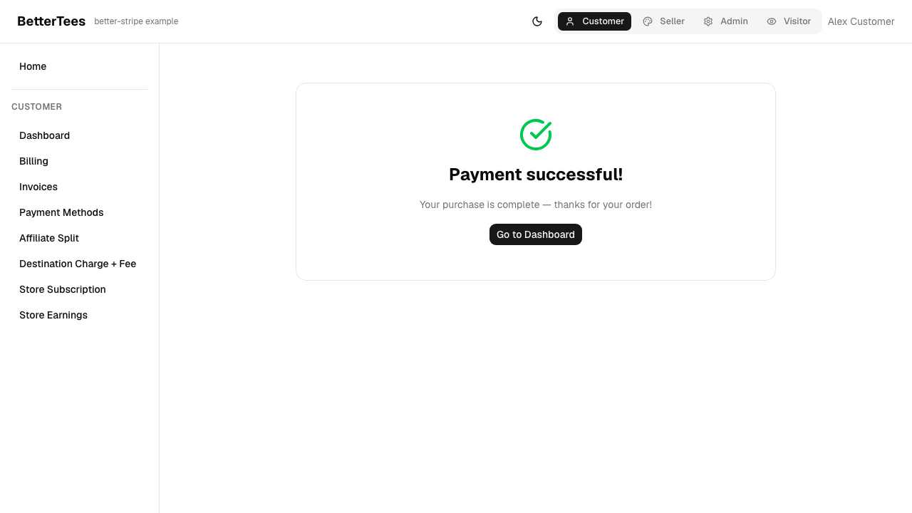
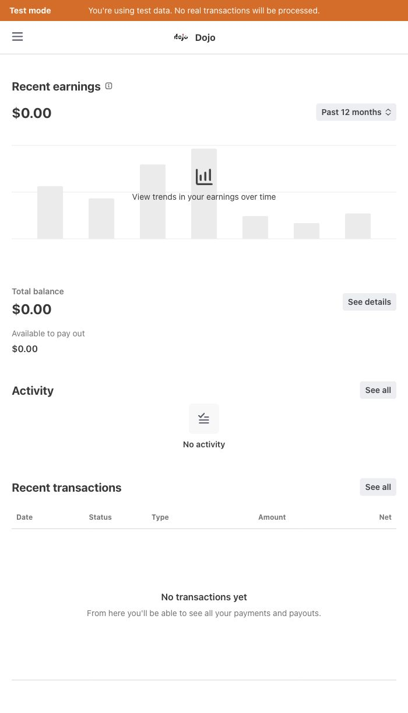

# Checkout and Express follow-up QA — 2026-10-11

Environment: localhost:5173, Convex development deployment `fabulous-egret-37`,
Stripe sandbox platform `acct_1TEQzE6JR7kThJog`. No production payments or
production configuration changes.

This follow-up resolves the direct-checkout and Express-login coverage gaps in
[the October 10 report](QA-2026-10-10.md). That report retains the original bug
reproductions and the remaining coverage limits for unrelated flows.

## Direct checkout

Completed the $100 non-referral purchase through embedded Checkout using
Stripe's synthetic Visa. The browser returned to Payment successful. A guarded,
internal read-only Stripe assertion confirmed the actual destination transfer:
$100 gross to the store's connected account, with a $3.20 application fee,
leaving $96.80 net. A single recipient uses a destination charge; it does not
create the separate-charge split ledger used by referred sales.

The regression test checks the destination against the seeded store, as well as
all three amounts. Referred checkout separately verifies $77.44 store,
$19.36 affiliate, and $3.20 platform.

## Express login

Completed the existing Jordan seller's Express sandbox onboarding with a
synthetic identity and Stripe Test Bank credentials. Stripe now reports:

- Account: `acct_1UOg6tG6sqNlXmmT`
- Dashboard: Express
- Details submitted, charges enabled, payouts enabled: true
- Currently due requirements: none

Clicked Seller → Account → Open dashboard and reached Jordan's hosted Stripe
Express dashboard. The dashboard shows Test mode, Dojo, and Recent transactions.
The automated regression matches the account shown by the app to the account in
the hosted login URL. Headless hosted login encountered a Stripe CAPTCHA; the
full dashboard was verified in the in-app browser. Hosted dashboard assertions
are separately opt-in with `E2E_STRIPE_HOSTED_LOGIN=1`. Single-use login
URLs and credentials are not included in this report.

## Validation

- Unit suite: 102 files, 1,397 tests passed.
- Library build, typecheck, lint, codegen drift check, and diff whitespace check passed.
- Direct purchase and referred purchase browser regressions verify payment and allocation.
- Final live browser run: 4 passed (direct checkout, referred checkout, route boot, Express login handoff).
- Express dashboard verified in the in-app browser; headless CAPTCHA limitation documented above.

The completed seller fixture, sandbox payments, and ledger records remain in the
development sandbox so the flows can be exercised again. Commands and fixture
prerequisites are documented in the example README.

## Screenshots

