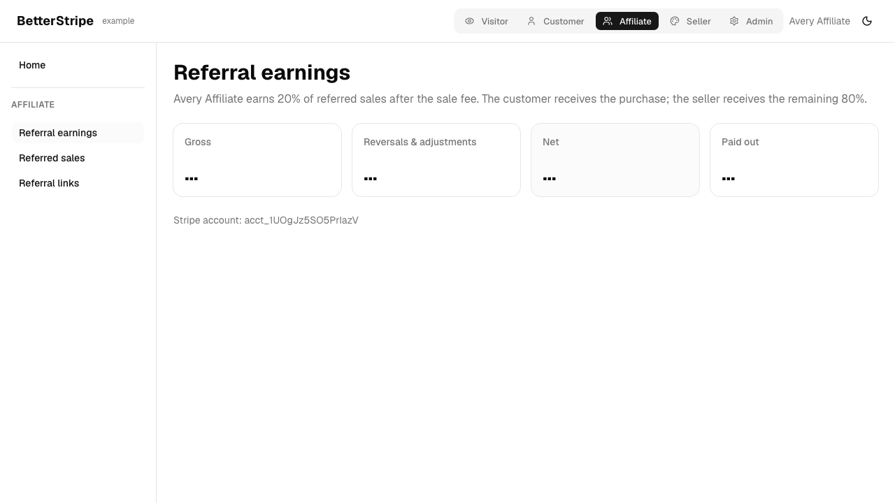
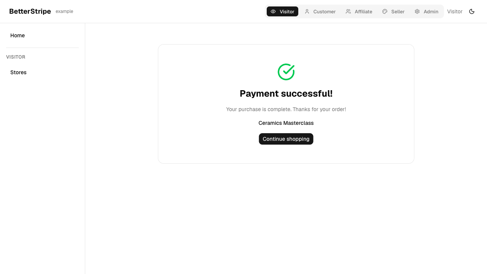
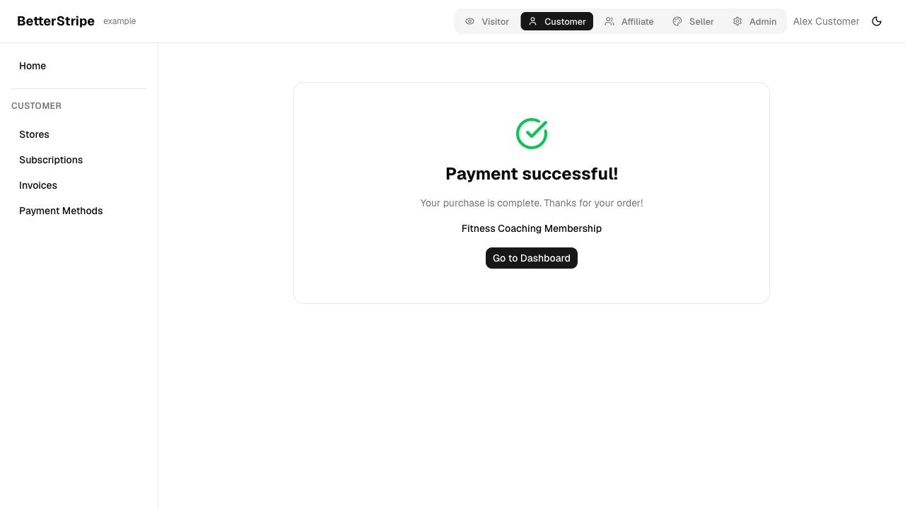
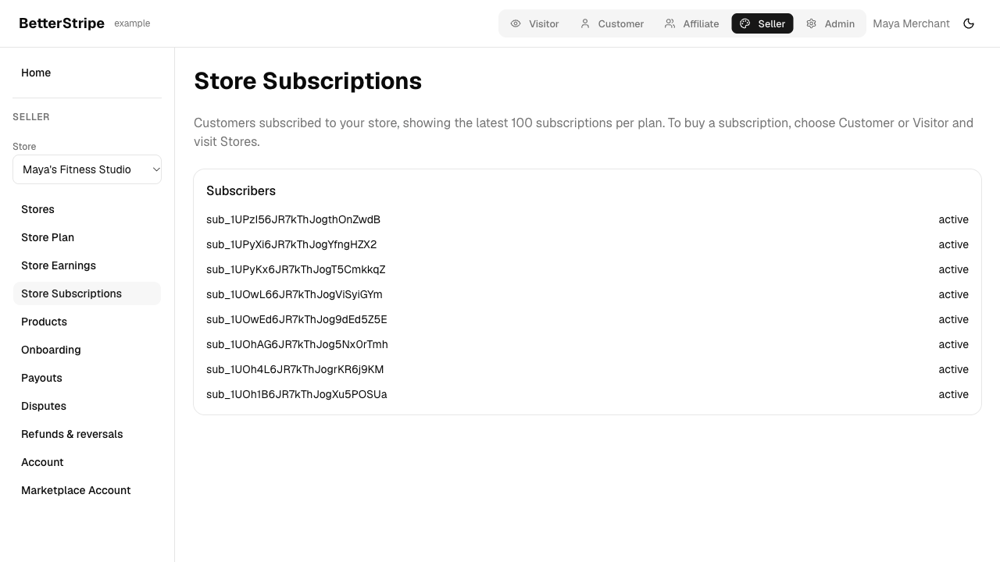

# Marketplace roles and sandbox QA, October 13, 2026

Tested localhost:5173 against Convex development deployment `fabulous-egret-37` and Stripe test mode. Branch `codex/marketplace-personas`, based on `0a360a3` with the local changes in this worktree. The worktree was first brought up to the current main branch to match the backend's existing Stripe Endive schema and preserve its working checkout fixes.

## Changes

| Persona   | Experience                                                                                                                             |
| --------- | -------------------------------------------------------------------------------------------------------------------------------------- |
| Visitor   | Public seller catalog and guest checkout, with or without an affiliate referral. No seeded user ID or personal billing pages.          |
| Customer  | Seller purchases, personal subscriptions, invoices, and payment methods. No seller or affiliate earnings.                              |
| Seller    | Store subscriptions, earnings, products, payouts, account, refunds, and disputes. A selector switches between Maya, Sasha, and Jordan. |
| Affiliate | Avery's separate Stripe account, referral links, and transfer earnings.                                                                |
| Admin     | Platform catalog, subscriptions, webhooks, testing, and setup.                                                                         |

Role menus, command navigation, and direct-page redirects share the same role rules. The example still uses a demonstration role switcher, not real authentication.

Checkout now uses the selected product's seller and actual price. Customer purchases bind to the active customer's Stripe account; guest purchases use the component's unattributed-user sentinel instead of charging Billie or a shared seeded visitor. Referral attribution survives store navigation and role switching. Checkout receipts identify the purchased product.

Seller and customer account resolution now uses the Stripe account explicitly linked to the persona. Older duplicate component accounts previously caused seller payouts and ownership checks to resolve the wrong account. Ownership assertions use this same account resolution.

## Verified payment allocations

| Flow                                                     |  Charge | Platform | Seller | Affiliate |
| -------------------------------------------------------- | ------: | -------: | -----: | --------: |
| Guest purchases Sasha's ceramics through Avery           | $129.00 |    $4.04 | $99.97 |    $24.99 |
| Alex purchases Maya's one-time coaching session directly | $100.00 |    $3.20 | $96.80 |     $0.00 |

For the referred sale, the stored guest checkout has no seeded customer ID. The charge is paid, both transfer rows exist, and their amounts plus the platform fee equal the charge. Avery's own page shows the charge. The rounding remainder now goes to the seller instead of increasing the platform fee by a cent.

The direct sale was completed both manually in the in-app browser and in a normal Chromium browser. A guarded read-only Stripe assertion confirms the actual destination account, charge, application fee, and seller net.

Alex also purchased Maya's $49 monthly plan. The stored checkout binds to Alex, the subscription appears in Alex's billing data, pause and resume synchronize through webhooks, and the seller subscriber view shows the subscription. Sandbox subscriptions and test payments remain available for further testing.

## Validation

- All five role page groups rendered, covering 26 role/page combinations. Customer and visitor menus exclude store finances, and non-admin roles redirect away from admin setup.
- 1,440 unit/component tests passed across 110 files; five additional direct finance-page role tests passed.
- Ordinary browser suite: 19 passed, 17 optional live tests skipped in that run. The skipped marketplace and admin flows were exercised separately as described here.
- Admin product creation, editing, and archiving passed. Seller navigation and refund/reversal controls passed. Six additional browser checks passed.
- Jordan's account-specific Express dashboard login handoff passed. Hosted account URLs are not retained in this report.
- Library and example typechecks, example production build, lint, Convex deployment, generated-code drift checks, and whitespace checks passed.
- React Doctor found three performance advisories: currency formatter construction and context value stability. No correctness error was reported. These do not affect the small seeded catalog's tested flows.

## Limits and test behavior

Live browser checks use Stripe's synthetic test card. No production payments or production configuration changes were made.

Stripe's embedded form stalled in headless direct checkout. Normal-browser direct checkout passed. A repeated subscription checkout also timed out in the embedded form after an earlier successful purchase/lifecycle run; the test harness was adjusted to explicitly select the USD currency control for both recurring and one-time layouts. The final USD subscription rerun passed, including the purchase, customer pause/resume, and seller subscriber visibility. The combined normal-browser run passed its other seven checks; the subscription then passed independently after the harness fix.

The page checks exclude next-themes' known development-console message about rendering an inline script; theme color switching and persistence passed. Application exceptions and other console errors remain failures.

Actual dispute acceptance, evidence submission, refund execution, transfer reversal, recurring affiliate payouts, and new-account hosted onboarding were not exercised in this run. Their pages rendered and the existing library/action tests passed, but those operations are not claimed as live end-to-end coverage. Physical shipping or course delivery is outside this Stripe example; checkout receipts and subscription state were verified.

Seller subscriber lists show the latest 100 subscriptions per catalog price. These are demo lists rather than a complete paginated operations history.

## Evidence

Browser recordings were retained locally during testing. Screenshots and renewal reports are included in this change.

Each role group and payment scenario uses named Playwright steps and assertions. Recordings are excluded from this public change.

## Sandbox fixtures and navigation follow-up

- Completed all 56 fixture steps using the configured Stripe sandbox: 40 sales,
  six refunds, four disputes with open/won/lost outcomes, three connected payouts,
  paid seller plans, and a customer subscription. Reconciled payout statuses
  from Stripe, rather than leaving the initial pending snapshot in the UI.
- Affiliate earnings now use four responsive cards. Referral earnings, referred
  sales, and referral links have separate routes and sidebar links. Desktop,
  mobile width, direct reload, and link navigation checks passed.
- Stores appears only for Visitor and Customer. Customer has Subscriptions,
  Invoices, and Payment Methods, with Dashboard removed from navigation. Seller
  starts with Earnings, followed by Billing, Sales, and Subscriptions.
- Refund/dispute costs are recorded from actual Stripe balance transactions.
  Recovery reserves are atomic with sale settlement; leftover balances are
  reserved once for the next draft monthly invoice. Tests cover repeated events,
  repeated invoices, reversed costs becoming credits, transfer limits, and
  invoice ownership. The next real monthly renewal has not been advanced in
  this sandbox; invoice attachment is covered by action tests.
- A live purchase exposed asynchronous Stripe processing fees. The app now
  schedules settlement retries itself instead of relying solely on Stripe's
  webhook redelivery. A regression test advances scheduled retries and verifies
  exactly one transfer. Replayed the affected sandbox event and recovered
  $44.18 of Sasha's outstanding costs from seller earnings.
- The earlier note that refunds/disputes were not exercised applies to the
  initial browser run. The fixture follow-up created real sandbox refund and
  dispute objects and submitted Stripe's test outcome evidence.

Final follow-up checks: 1,495 tests passed across 120 files, example TypeScript
passed, and the production build passed. All five role page groups passed.
Affiliate desktop/mobile navigation and seller renamed-menu navigation passed.
The direct customer checkout passed after the scheduled-settlement fix, including
seller cost recovery. A repeated guest checkout timed out in Stripe's embedded
form before the return URL; this remains an intermittent sandbox/browser test
limitation. The earlier guest payment completed and its delayed settlement was
recovered by replaying the actual Stripe event. No monthly renewal end-to-end
claim is made.

## Account, balance billing, and runtime stability

- Account now combines Details, Setup, and Stripe settings, with old URLs
  redirecting to the appropriate section. Billing follows Account in the sidebar.
- Billing's itemized estimate was checked against the actual Stripe preview.
  Refund and dispute cost tables moved to their respective pages.
- Created and attached a real sandbox Stripe balance payment method. Browser
  checks verified explicit consent, enabling it on Sasha's existing subscription,
  and opting out to restore the previous saved method. These checks configured
  future renewals; they did not advance the billing cycle or charge a renewal.
- Removed next-themes' injected script from this client-rendered app. Local theme
  handling preserves the existing storage key, system theme, hotkey, and toast
  styling. Unit checks cover theme persistence and changes from another tab.
- Role context identity now survives Vite hot reload. A browser regression check
  changes and restores the provider source, navigates to Payouts, toggles theme,
  and reloads while asserting no page errors or React script warnings.
- 1,501 tests passed across 123 files. TypeScript passed. The affected Account
  page in the user's browser was reloaded and visibly restored.

## Real monthly renewal charges

- Advanced isolated Stripe test clocks through a real monthly renewal. A $9
  Starter plan plus $16.47 of actual refund/dispute costs produced an itemized
  $25.47 invoice and exactly one Stripe balance debit. Available seller earnings
  fell from $182.00 to $156.53. The subscription remained active. Retrying the
  paid invoice was rejected by Stripe and did not debit again.
- With no available earnings, the same $25.47 renewal remained unpaid with
  `insufficient_funds`, no balance debit, and no store access. Stripe returned
  that value in `last_payment_error.code`, with `generic_decline` in
  `decline_code`. Tests accept either location for `insufficient_funds`.
- After new earnings arrived, retrying the same invoice collected $25.47 once.
  Previously invoiced refund/dispute costs were not also withheld from those
  earnings. This sandbox canceled the subscription on the failed payment with
  cancellation reason `payment_failed`. Paying its invoice afterward did not
  reactivate it. Recovery settings must retain the subscription during retries
  for successful retry payment to restore store access.
- Stripe documents retrying a failed balance invoice with another payment
  method. Automatic saved-card fallback is not implemented or claimed tested.
- Fixed webhook subscriptions missing refund/dispute events, delayed actual-fee
  reconciliation, attaching costs to already-paid initial invoices, and paid
  access calculations under Stripe test clocks. The regression suite passed
  1,504 tests across 124 files. Example build, backend typecheck, affected-file
  lint, and seller navigation browser checks passed. The seller menu now says
  Refunds.

Funded payment evidence is in
`qa/2026-10-13/balance-renewals-renewal-20261013-f.json`. That run's recovery
assertion originally expected a paid invoice to reactivate a subscription;
Stripe's cancellation result disproved that assumption. The renewal runner now
records and checks both retained-subscription and canceled-subscription outcomes.
The corrected insufficient-balance scenario passed, with evidence in
`qa/2026-10-13/balance-renewals-renewal-20261013-g.json`.

## PR verification

- Added store names to referred sales, including legacy split-transfer sales. Referral links have per-store copy buttons; a browser test checks the full copied affiliate URL.
- Seller and affiliate use the same account-scoped Payouts page with live Stripe balances, next scheduled payout amount and arrival date, upcoming payouts, and paginated history. Paid or failed payouts are excluded from upcoming results even if Stripe returns them in a filtered list.
- Full unit suite: 1,509 tests across 125 files passed. Library and example builds, typechecks, lint, and structural codegen checks passed.
- Automatic saved-card fallback remains unimplemented. Balance Pay is a Stripe preview feature, and failed-payment recovery depends on the platform's Stripe settings.
