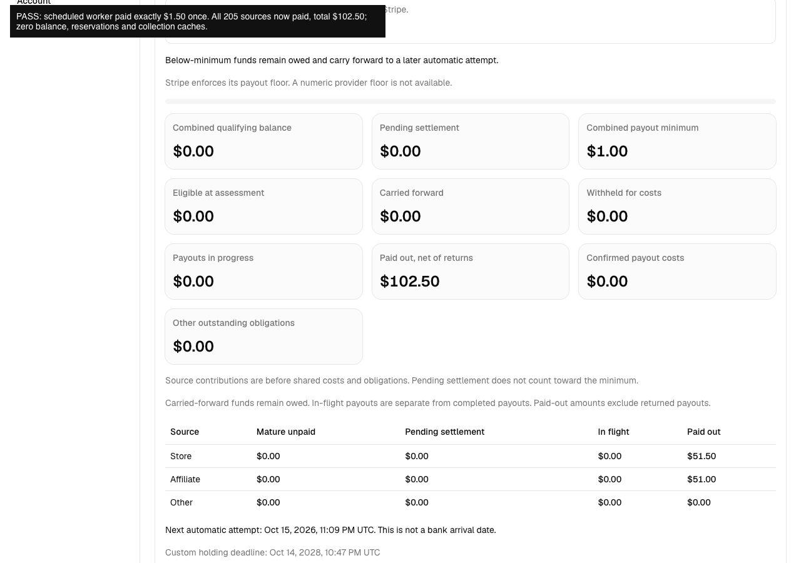
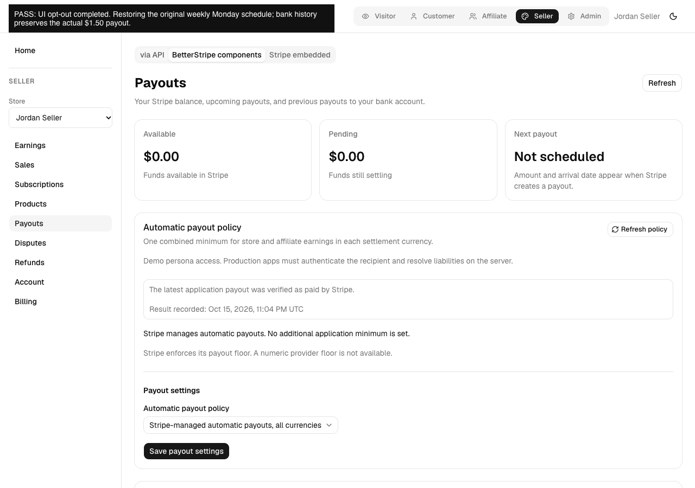

# Paginated payout binding and versioned recovery evidence

Code tested: `db53b48767e4de478f6dbfedcf046021c6be9a66`, branch `codex/payout-collection-binding`.

[Watch the native browser excerpt](./verified-excerpt.webm). This is the final three minutes of the original 1280×900 capture at normal speed, with no fabricated UI or removed actions inside the excerpt. Earlier setup and provider waits are omitted; screenshots and JSON preserve the earlier assertions. The long original is retained locally. Caption assertions are test annotations, not product data.

## Actual Stripe sandbox results

- Custom minimum $1.00 activated through UI consent on one owned test recipient.
- 205 actual source transfers × $0.50 = $102.50, alternating store/affiliate classifications.
- 101 actual prior bank payouts × $1.00 = $101.00, all verified paid with their exact debit receipts. Remaining available balance: $1.50.
- A bounded package worker call with `maxPages: 1` returns `collection_pending` at step 25. It creates no payout and retains operation/sequence 1.
- The unchanged production five-minute cron resumes that same operation in generation 2. Complete local membership contains 205 sources, 101 claims and 202 prior allocations. No clock or deadline timestamp fixture is used.
- The actual scheduled package worker creates and verifies one $1.50 payout, `po_1UQxhj553kfw9JNQ0yHydfwz`, debit `txn_1UQxhj553kfw9JNQK8WWD2Ih`, fee 0. Runtime: 160,313 ms from attempt start to recorded result.
- All 205 source allocations now account for $102.50 paid principal; reserved principal 0, financial claim count 102, collection cache empty, provider balance 0. Two immediate dispatcher replays create no duplicate and preserve generation/sequence.
- Browser history loads all 101 baseline payouts across two pages. A first test assertion ran before the second page finished rendering; the subsequent settled DOM verified all 101 rows, without a product change.
- Refreshed API assessment shows $102.50 paid total, $51.50 store and $51.00 affiliate, zero unpaid/pending/reserved funds, and a verified paid latest attempt. UI opt-out restores the original weekly Monday schedule. BetterStripe components mode preserves the actual paid bank history and Stripe-managed status.
- Fresh provider checks confirm weekly Monday scheduling, zero available/pending balance and no in-flight payouts before closing only the owned recipient. Cleanup succeeded. The owned QA backend/browser/controller were stopped and its private deployment retired; the shared localhost:5173 app still returned HTTP 200.

## Fixture scope and limitations

Stripe transfers, payouts, balances and receipts are real sandbox API responses. Prior source allocations and historical claims are imported by a private allowlisted fixture into the copied component using the actual paid receipts. This proves larger-history execution, **not** the separately bounded public historical-adoption API, tracked in BTS-191. The private fixture does not ship. Funding role labels are test host classifications, not customer checkout/commission evidence. USD is the supported live case here; no numeric provider floor is invented.

The production cron, worker, adapters and financial binding modules in the isolated runtime match the source build; hashes are included. Additional private exports provide only bounded test setup and inspection. No shared localhost app or production account is modified.

## Verification

All 15 repository gates pass; 77.5% line coverage. 143 focused package tests and 21 example tests pass. The original failing refund-cost race and final logs are included. Two new multi-pass integration scenarios explicitly allow 15 seconds under coverage; existing budgets/floors are unchanged. React Doctor reports four warnings about sequential indexed Convex reads; the live supported scan completed within the ten-minute action limit. This is not a performance guarantee for every workload.

The versioned-liability regression is deterministic component/client evidence. It proves new/increased/decreased costs invalidate stale qualification, fresh quotes pay exact net entitlement, and unknown/attempted claims never create replacements. It does not claim a new live customer-refund scenario in this recording.

Parent payout and linked Dojo consumer acceptance remain open. See the separate holding-deadline audit for the scope already proven by the earlier merged fixes.

