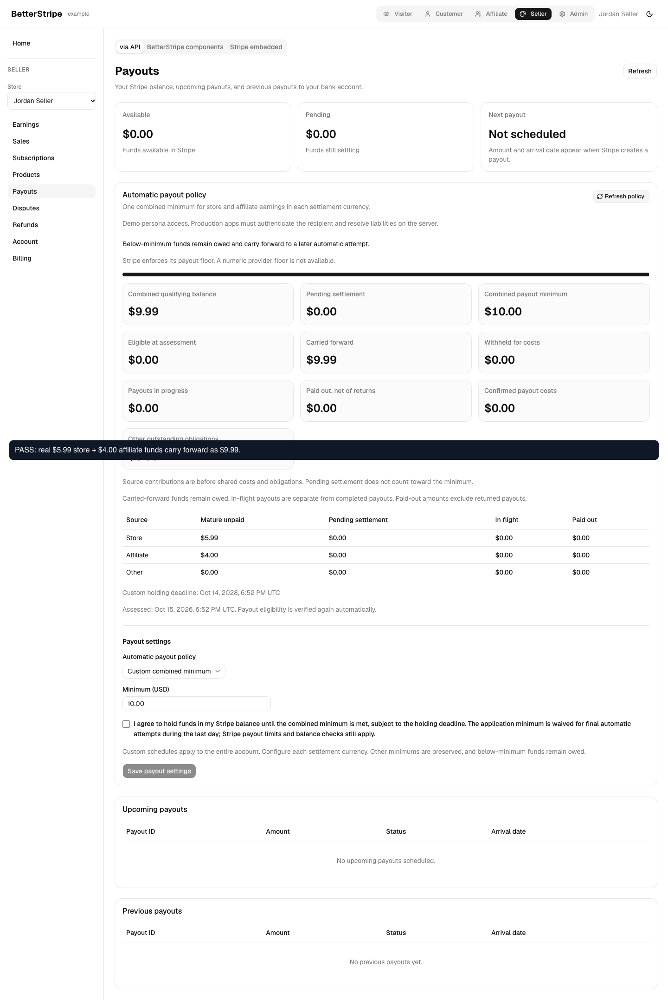
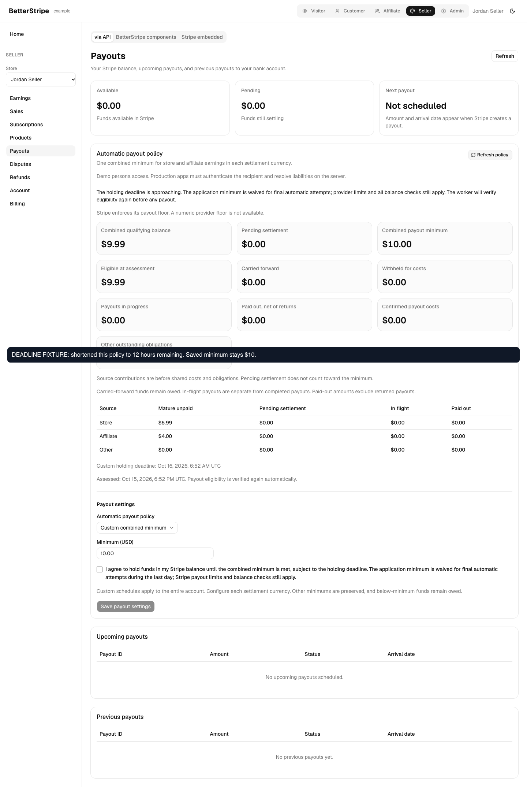
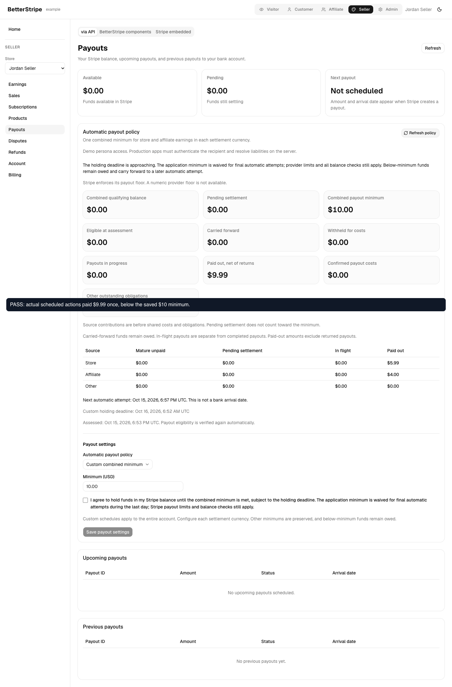
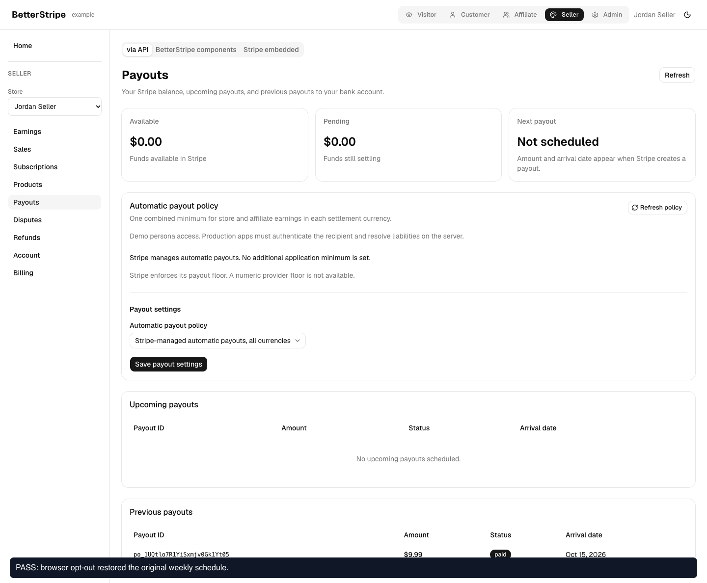

# Funded final-window payout evidence

Browser/provider source: `8968474`. Final PR head: `38e7bb4e37effd66450bdfe48df5b99dcd5bdbc3`, which adds one test for a pre-existing job with a later stored cadence. Production behavior is unchanged from the browser run.

[Watch the recorded browser flow](./deadline-readable.webm). Empty capture padding is cropped and the viewport scaled, without removing actions. Some early and final frames have browser capture clipping; the full-page screenshots below preserve all columns and text.

## Results

Five browser assertions passed without page runtime errors:

1. Browser activation requires consent and verifies manual scheduling against the actual provider.
2. Actual sandbox transfers of 599 store and 400 affiliate minor units carry forward below the saved 1000 USD minimum.
3. A private timestamp fixture shortens only this policy deadline to 12 hours remaining. Preview qualifies the actual 999 balance, retains the 1000 configured minimum, and explains the waiver.
4. Calling the actual example dispatcher runs scheduled actions that create exactly one 999 USD payout. Stripe reports it paid; the package worker records paid and releases the operation. Repeated dispatch creates no duplicate.
5. Browser opt-out restores the original weekly Monday schedule.

The disposable recipient was restored and closed with zero remaining balance and no in-flight payouts. The local QA deployment and browser were retired after the run.

## Verification scope

The full isolated example backend uses real Stripe sandbox responses and package functions. There is no mocked balance, transfer, payout or UI response. All 92 production component modules match the source build; only the private copied mutation file appends `qaFinalDayFixture`, included here. Hashes are in `provider.json`. The helper is allowlisted to one recipient and can only shorten its deadline. It is not shipped or deployed to the cloud example. This is not a Stripe Test Clock or 730 days of elapsed time.

The dispatcher entry point was invoked during the recording; its scheduled actions execute the real bank-payout boundary. The recording does not claim that 24 hours elapsed or that the recurring cron timer itself fired during this short run.

- 59 focused tests passed, including existing-job scheduling, final-day retry cadence, liabilities, unknown outcomes, zero balance and provider rejections.
- All 15 repository gates passed at the final PR head; see `repository-gates.log`.
- React Doctor reported no issues, 88/100 across 12 changed files in the package/example.
- The RED logs show the prior below-minimum hold and daily retry skipping the final window.

This proves pre-deadline release for the supported funded sandbox case. It does not complete late funded expiry, exhausted/provider-rejected recovery, full live refund/dispute coverage, large-history qualification or linked Dojo adoption. BTS-187, BTS-171 and BTS-172 remain open for those acceptance items. A schedule restoration alone is not proof of disbursement.

