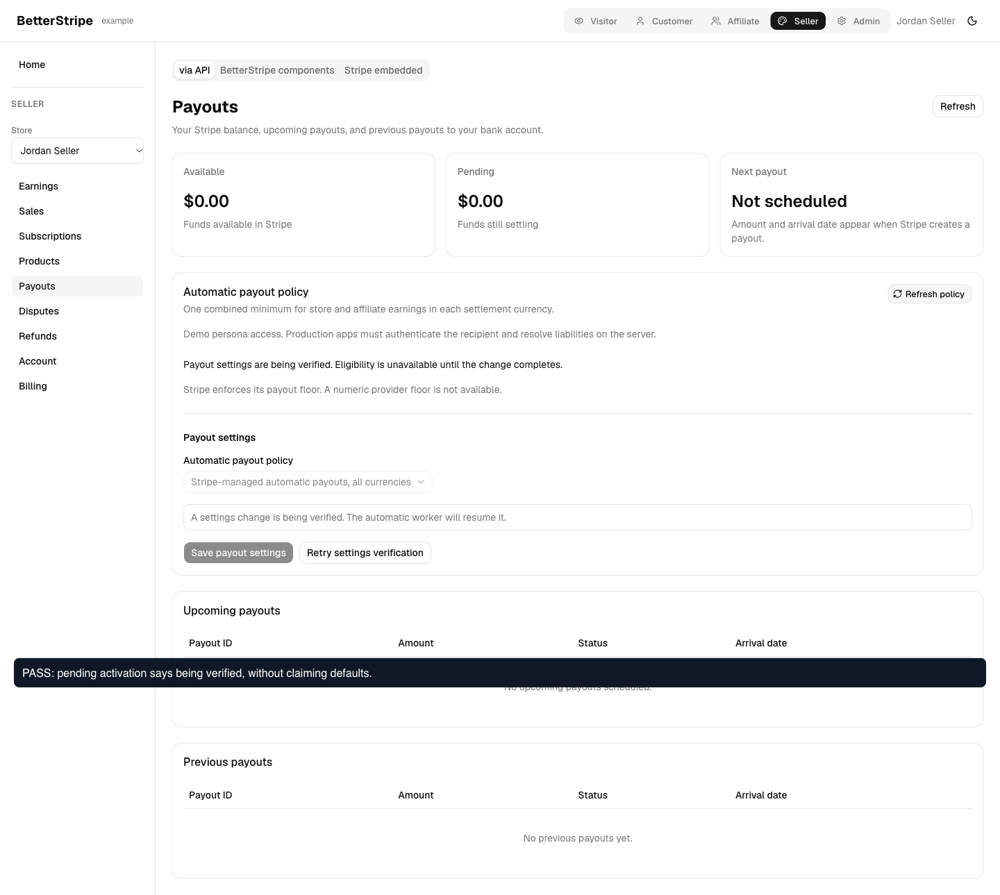
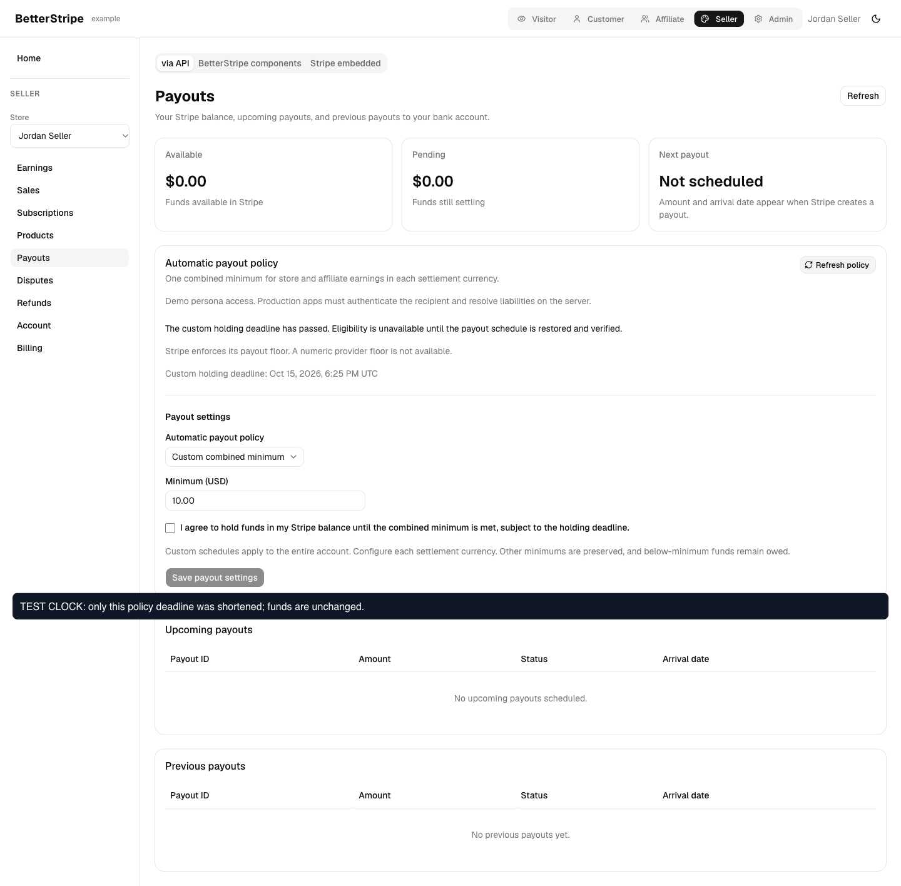
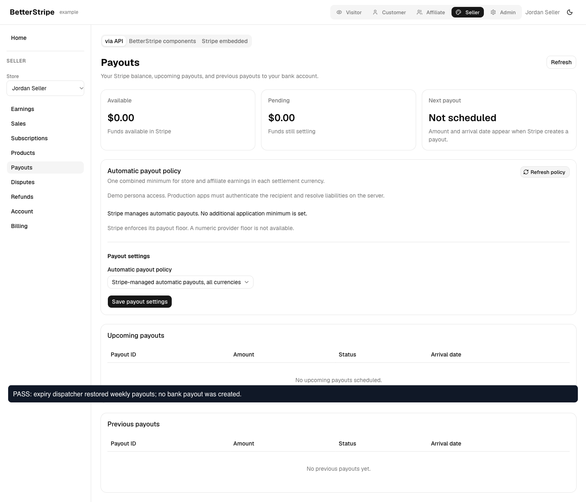

# Payout policy UI and expiry control evidence

Financial/UI source tested: `7e871dcedd020a54b3b67e0529455149edc55570`.
Final PR source: `5ad31b287a6345a655e23ebb499e3c3d8025e96f`. The merge only synchronizes v0.28.1 release metadata, README version and changelog. Production and test code are unchanged from the browser run.

## Recorded behavior

[Watch the UI flow](./expiry-readable.webm). The video crops empty capture padding and scales the original viewport. No actions are removed.

1. The real public SDK prepares a custom policy from weekly Stripe-managed defaults. The example refresh shows the pending operation as unverified, without claiming default controls are ready.
2. Clicking Retry settings verification applies the persisted operation. The provider reports manual scheduling. The initial US deadline is exactly 730 days after the preparation observation.
3. A private local QA fixture shortens this one policy deadline. Refresh shows the explicit expired reason without invented financial progress.
4. The actual example dispatcher and scheduled expiry action restore the original weekly Monday provider schedule and clear the deadline.
5. Repeated dispatch preserves the completed operation key and revision, with zero payouts.

## Scope and limitations

This is a real Stripe sandbox recipient and the full isolated example backend. Provider responses are not mocked. Only the local component copy has an allowlisted internal helper that shortens a single policy timestamp. The helper is included in `deadline-fixture.js.txt`; it is not shipped or deployed to the cloud example. All 91 production component modules match the source build; the copied mutation module preserves its original code and appends only the helper. Hashes are in `provider.json`.

The video annotation says TEST CLOCK at the fixture step. This means the application deadline fixture described above, not a Stripe Test Clock or 730 days of real elapsed time. `browser-test.js.txt` uses the clearer DEADLINE FIXTURE wording.

The SDK prepare call supplies the example consent fixture; the video tests the actual browser retry callback, not a fresh UI consent submission. No funds were added and no bank payout was created. This proves expiry control restoration, not funded deadline disbursement or the whole BTS-171/BTS-172 scope. Funded below-minimum expiry and linked Dojo adoption remain open acceptance work.

## Verification

- 32 focused client/React tests passed, including failed expiry restoration retry and both prior-mode pending states.
- All 15 repository gates passed on final commit `5ad31b2`; full log in `repository-gates.log`.
- React Doctor scored 100/100 for the three changed package React files.
- Five browser assertions passed with no page runtime errors.
- Actual scheduled function outcomes are in `scheduled.json`; provider checkpoints are in `provider.json`.
- Cleanup verified weekly restoration, zero payouts and closure of the disposable recipient. Local QA servers were stopped and their config restored.

