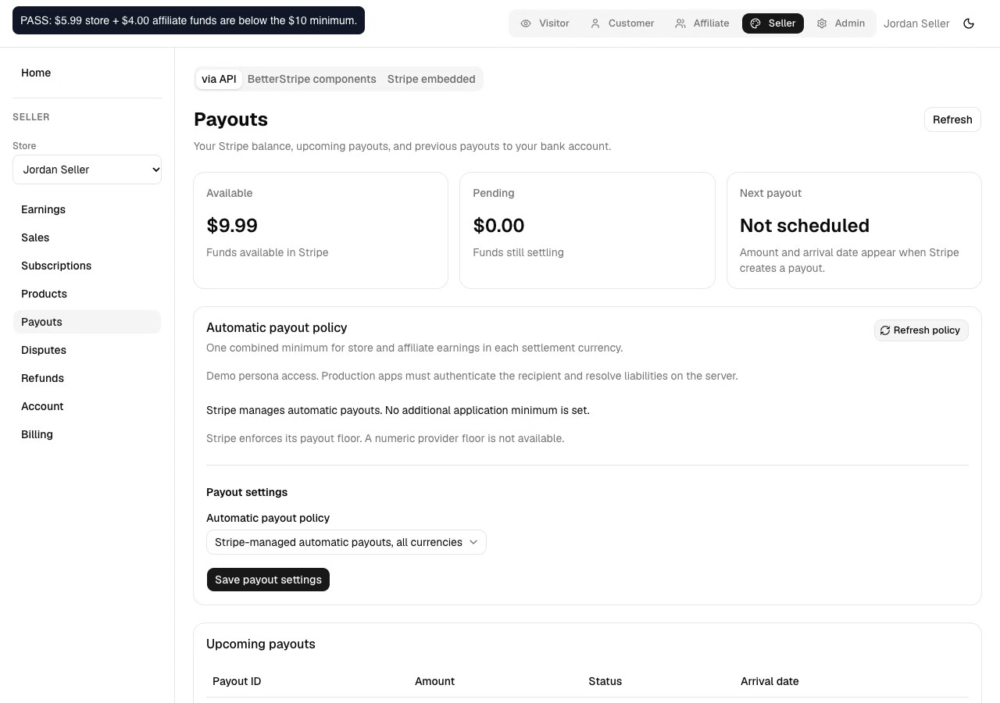
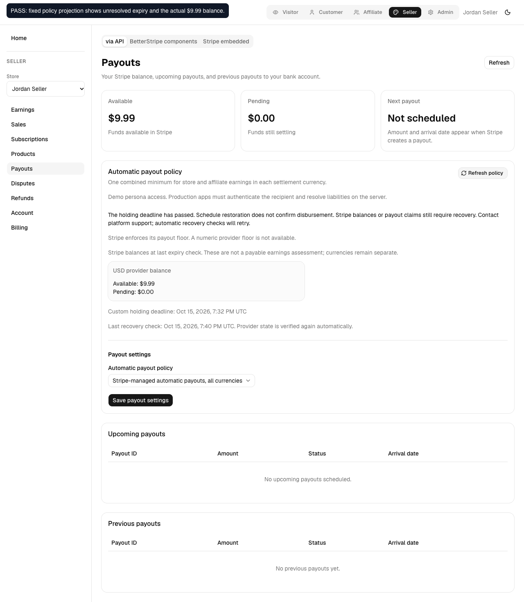
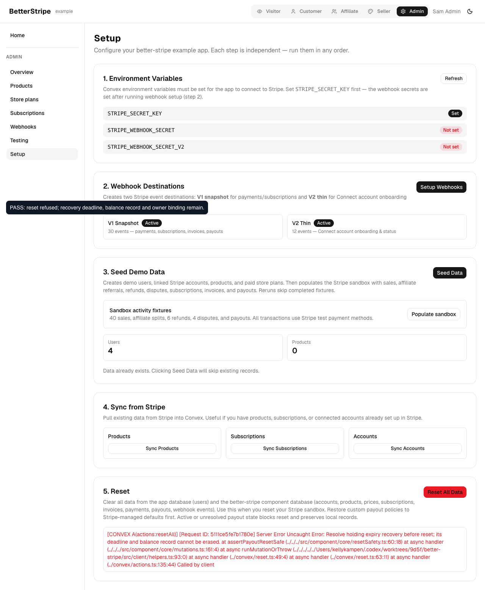
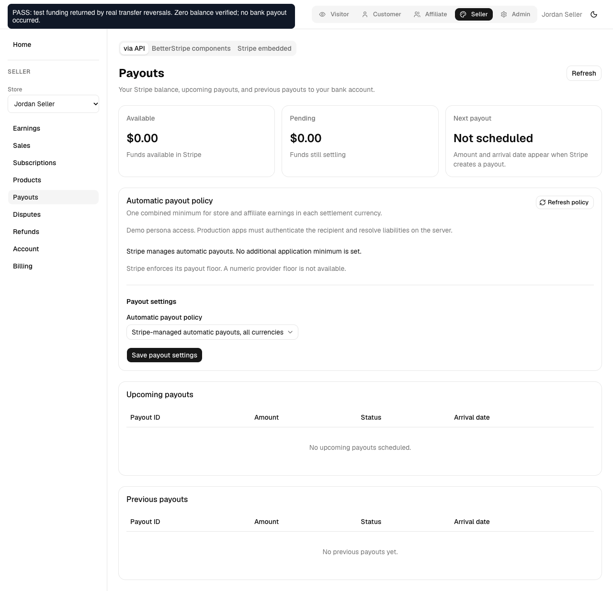

# Holding expiry recovery evidence

Passing browser/provider source: `aabb7978ce02c5054b71701caf09a44a680b3d02`.
Final PR head: `6968168449a593b21ee54ef2d204184642ff97a3`. Later commits synchronize v0.28.3 release metadata, document DTO/legacy migration, and normalize extra scope fields before component mutations. Recorded calls already use the same canonical account/owner inputs. The additional full-policy-document input path is covered by its regression test; it is not claimed as a separate browser assertion.

[Watch the verified browser flow](./verified.webm). This is the original 1280×900 recording, without cropping or removed actions. It resumes the same funded sandbox recipient after correcting the example policy projection.

## Actual sandbox behavior

The isolated full example created a disposable recipient and activated a $10 custom minimum through browser consent. Actual transfers funded 599 store and 400 affiliate USD minor units. A private allowlisted fixture shortened only this policy timestamp to force expiry. The actual dispatcher/scheduled action restored weekly Monday scheduling and retained the 999 available balance, original deadline and `balance_remaining` status. No payout was created.

The first browser run found a real integration bug: the example's policy view dropped `holdingExpiry`, causing the UI to claim default scheduling despite the unresolved record. `projection-before.log` and the before screenshot show the failure. The mapper now forwards the shared package validator's recovery field. A separate interrupted test had a persona-init mistake in the test script; correcting it changed no product or financial state.

The verified run passed six assertions with no page runtime errors:

1. The API view shows unresolved expiry and actual $9.99 balance after weekly restoration.
2. BetterStripe components mode shows the same recovery record.
3. Repeated dispatch preserves restoration identity and creates no payout.
4. Browser reset refuses unresolved expiry and preserves the owner/deadline/balance record.
5. Actual transfer reversals return the test funding. Fresh zero balances clear recovery without claiming bank payment.
6. Browser reset succeeds after verified recovery, with provider scheduling still weekly.

`provider.json` records before/after checkpoints and real transfer/reversal IDs. Recovery here was funded by reversing the disposable test transfers, not a bank payout or customer refund. The package preserves a `no_held_balance` observation, which does not claim bank arrival or forgiveness of other obligations.

## Verification

- 67 focused package tests passed, including unknown claims, restoration retry, lost recovery writes, stale observations, concurrency, reset protection, currency separation, and final-window refund/reversal deductions.
- 13 example action tests passed, including preservation of recovery in the public policy view.
- All 15 repository gates passed on the final merge head; see `repository-gates.log`.
- React Doctor reported no issues, 89/100 across 19 changed files.
- Actual operator warnings are in `operator-warning.log`.

## Isolation and limitations

All 93 production component modules match the source build. The copied mutation module preserves its original code and appends only the helper in `deadline-fixture.js.txt`; hashes are in `provider.json`. The QA controller and independent cleanup scripts are included as text with workspace paths normalized for review. Funding roles are host fixture classifications on real transfers; this is not a customer-checkout test.

The fixture is not shipped, not deployed to the cloud example and not a Stripe Test Clock. This does not simulate 730 days of provider-held cash.

The browser run completed with six passing checks. The private fixture watcher also exited on a workspace dependency symlink recursion after the successful safe reset. Independent fresh Stripe API checks then verified weekly scheduling, zero balances, no payouts and closure of the disposable recipient. The local QA deployment and browser were retired. This watcher limitation is specific to the private workspace fixture and is not presented as a production check passing.

This is a supported USD sandbox control/recovery test. Provider permission/floor rejection and unknown-outcome cases have focused test coverage; this recording does not claim all-country live coverage. Proactive final-attempt failure presentation, larger-history qualification and linked Dojo adoption remain open work under the parent tickets.

